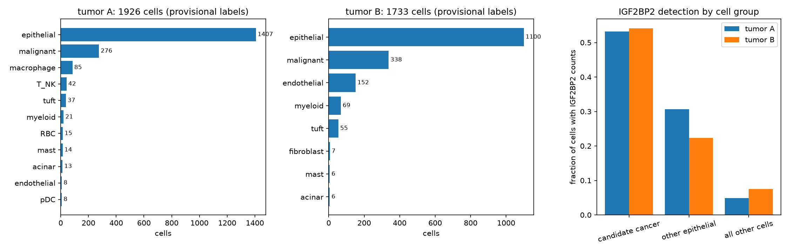
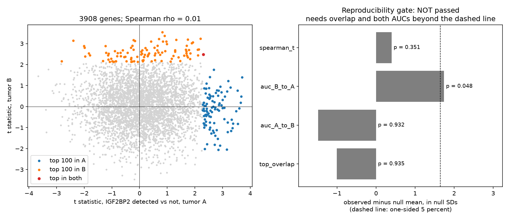
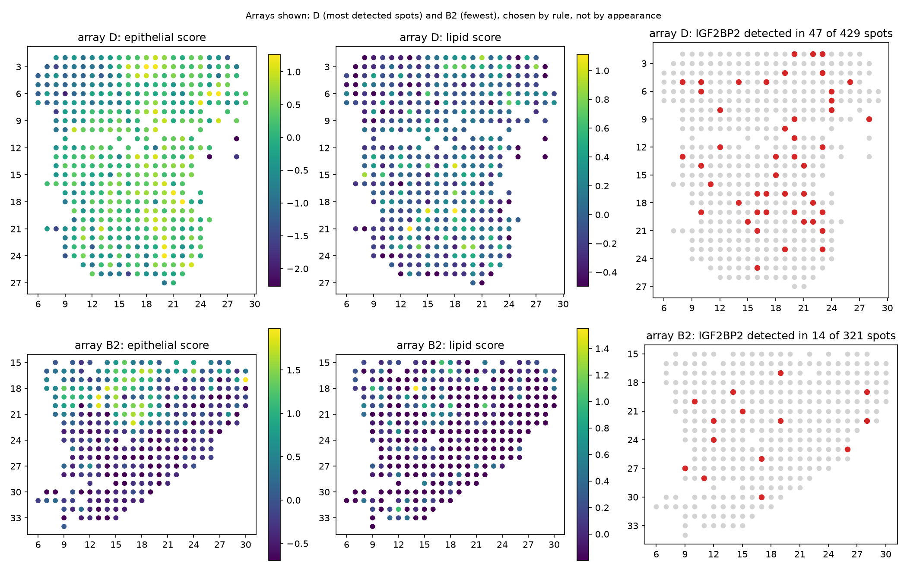
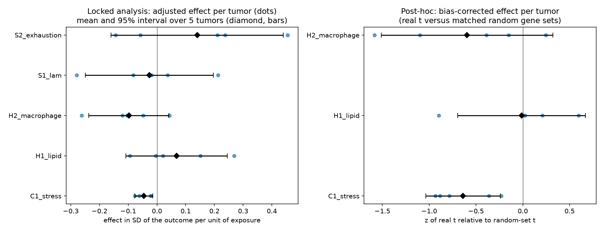
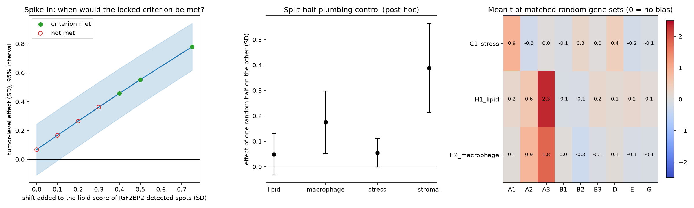
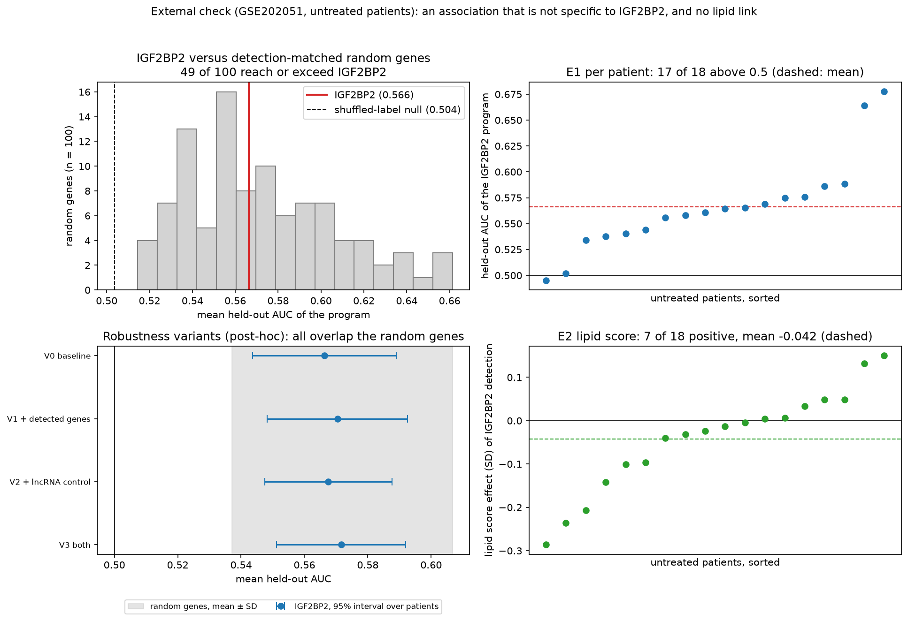

# A spatially aware reassessment of an IGF2BP2-high malignant state in pancreatic ductal adenocarcinoma

[Your full name] | BINF6420 | [date]

## Abstract

Chen et al. (2026) describe a pancreatic cancer cell state marked by high IGF2BP2 and link it to lipid metabolism and an immunosuppressive microenvironment [CITE]. We reassessed part of this claim with public data and a design that fixes analysis rules before results are seen, counts tumors or patients as the independent units, and uses negative controls. In the spatial transcriptomics and single-cell data of Moncada et al. (GSE111672; nine arrays from five tumors), IGF2BP2-linked genes found in one tumor did not reproduce in the other. IGF2BP2 detection in spots showed no clear association with a lipid score (mean effect 0.068 SD, 95% interval -0.108 to 0.245) or a macrophage score (-0.098 SD, -0.237 to 0.041). A positive control failed, and a spike-in analysis showed that only effects of about 0.4 SD would have met our criterion. In an external single-nucleus dataset (GSE202051; 18 untreated patients, 52,999 cancer nuclei), a program derived in the other patients separated IGF2BP2-detected nuclei (mean AUC 0.566), but 49 of 100 detection-matched random genes did as well or better, so the association is not specific to IGF2BP2. No lipid association was found (-0.042 SD, -0.101 to 0.017). We conclude that these data give no evidence for an IGF2BP2-specific malignant program with lipid or immune links. They cannot refute the original claim, because every test uses IGF2BP2 detection as a stand-in for a state defined by clustering.

## 1. Introduction

Pancreatic ductal adenocarcinoma has a dense, immunosuppressive microenvironment. Chen et al. (2026) report a malignant cell state, State 3, with high IGF2BP2, and propose that it promotes immune evasion through lipid metabolism and PD-L1 localization, with a candidate drug [CITE]. Their spatial validation used sections of two tumors (PDAC-A and PDAC-B) from Moncada et al. (2020) and spot-level correlations between a state score and a T-cell exhaustion score [CITE].

Spot-level correlations in spatial transcriptomics can mislead for three reasons. A spot mixes many cells, so a spot rich in tumor cells scores high for every tumor-related gene whatever its surroundings. Spots near each other resemble each other, which inflates significance. And sequencing depth varies between spots. A fair test therefore needs adjustment for composition and depth, a null model that respects spatial structure, negative controls, and tumors, not spots, as the units of replication.

We asked whether the IGF2BP2-high state is reproducible across tumors, and whether it co-locates with lipid and immune signatures once these problems are addressed. The supplement of Chen et al. contains no gene list for State 3, so the state could not be reused and was approximated by IGF2BP2 detection. Section 5 discusses what that choice limits.

## 2. Methods

### 2.1 Data
GSE111672 (Moncada et al. 2020) provided single-cell RNA-seq for tumors A (1,926 cells) and B (1,733 cells), and nine spatial arrays from five tumors: A1 to A3 (428, 316, 288 spots), B1 to B3 (224, 321, 242), D (429), E (359), and G (288). Arrays from one tumor are not independent, so the unit of replication is the tumor (A, B, D, E, G). PDAC-F was excluded because its file was truncated (5,757 genes, IGF2BP2 absent), and PDAC-C because it has no spatial data. A matched single-cell reference exists only for tumors A and B.

GSE202051 (Hwang et al. 2022) provided an external single-nucleus dataset: 224,988 nuclei, 22,164 genes, 43 patients, with the authors' cell-type labels and treatment status. The authors' labels identify 64,538 cancer nuclei, identically in three label columns. Chen et al. also used this dataset for other analyses [CITE].

### 2.2 Cleaning and quality control
PDAC-D contained 29 duplicated spot columns with identical content, and the first of each was kept. Twenty-seven gene names that a spreadsheet had converted to dates (for example 1-Mar) were renamed and excluded from all signatures. Median UMIs per spot varied seven-fold between arrays (403 in A3 to 2,994 in D), so log total UMI was a covariate in every spatial model. IGF2BP2 was detected in 4 to 16% of spots (14 to 47 spots per array), and single-gene maps were not interpretable, so multi-gene scores were used.

### 2.3 Single-cell annotation
Cells were normalized and clustered (Leiden, resolution 0.8; 18 clusters in tumor A and 16 in B) and labeled by marker genes. Candidate cancer cells were clusters 5 and 6 in tumor A (276 cells) and cluster 0 in tumor B (338 cells). They agree with markers reported by Moncada et al. (TM4SF1, S100A4). Copy-number evidence was not available, so these are candidates and not confirmed malignant cells.

### 2.4 Reproducibility gate (step 03)
In candidate cancer cells of each tumor we tested every gene for association with IGF2BP2 detection (t statistic, adjusting for depth and a cell-cycle score; 3,908 genes). A program (the top 100 genes) from one tumor was tested in the other by AUC, against shuffles of IGF2BP2 labels among cells of similar depth. The gate, fixed in advance, required both held-out AUCs above 0.5 with p < 0.05 and a significant top-100 overlap.

### 2.5 Spatial tests (step 04)
Per-spot scores were the mean z-scored expression of each signature: a 15-gene lipid score (hypothesis H1), a macrophage score (H2), and epithelial and stromal scores as covariates. Exposure was IGF2BP2 detection. Each model adjusted for log total UMI, epithelial score, and stromal score. Significance used a block-permutation null (5 by 5 grid units, 1,000 shuffles) and a comparison with 200 matched random gene sets per outcome. A positive control (a stress module against the stromal score) was included. Results were aggregated over the five tumors, and the criterion fixed in advance required the same sign in at least four of five tumors, a 95% t-interval excluding zero, and a median p against random sets below 0.05.

### 2.6 Post-hoc diagnostics (step 05)
Three post-hoc checks followed. A spike-in added known shifts to the lipid score of IGF2BP2-detected spots to find the smallest effect that meets the criterion. A split-half control tested whether two random halves of a signature co-vary through the same models. And the average test statistic of matched random gene sets was computed per array, to detect bias.

### 2.7 External check (steps 07 to 09)
Cancer nuclei were those labeled "Epithelial (malignant)". A patient was eligible with at least 30 cancer nuclei with and 30 without IGF2BP2 counts; all 18 untreated patients were eligible, and 26 patients overall. The primary population was the untreated patients.

E1 asked whether an IGF2BP2-linked program reproduces across tumors. For each patient, genes were tested against IGF2BP2 detection (adjusting for depth and cell cycle), a 100-gene program was built from the other patients, and its score was tested in the held-out patient by AUC. The statistic was the mean AUC over patients, against 200 shuffles of detection among nuclei of similar depth. E1 passed if the mean AUC exceeded 0.5, the empirical p was at most 0.05, and at least 60% of patients had an AUC above 0.5. E2 asked whether the lipid score is higher in IGF2BP2-detected cancer nuclei, using the same covariates and 200 random gene sets per patient. A secondary exposure (expression above the patient's median) was added before any association was computed.

Step 09 (post-hoc) re-ran E1 with additional covariates (log detected genes, a nuclear lncRNA score), with lncRNA-like genes barred from programs, and with 100 random genes whose per-patient detection matched IGF2BP2 as the exposure.

### 2.8 Pre-specification and reproducibility
Analysis rules were committed before their results existed, and every later addition is labeled post-hoc in `docs/input_manifest.md`. The external plan is commit 6f419e3, the secondary exposure dc82ec8, the analysis script and clarifications 804a97b, and the robustness plan 1ae8e72. The pipeline is Nextflow on Slurm with fixed seeds (Python 3.11, scanpy 1.11.5). A clean-room run of the main pipeline from a fresh clone (dc82ec8) completed in 7 minutes 17 seconds, with ten key result tables byte-identical to the original runs.

## 3. Results

### 3.1 Cell calls
Candidate cancer cells carried IGF2BP2 counts more often than other epithelial cells (about 53% and 54% against 31% and 22% in tumors A and B) and far more often than all other cells (Figure 1). IGF2BP2 is therefore partly a cancer-lineage marker, which is why tumor content must be adjusted for.

### 3.2 Reproducibility gate
The gate was not passed (Figure 2). The top-100 overlap was one gene (DIP2B) against 2.6 expected by chance (p = 0.935). The held-out AUC was 0.459 from A to B (p = 0.932) and 0.554 from B to A (p = 0.048). Across 3,908 genes the correlation of the two tumors' statistics was 0.008.

### 3.3 Spatial tests
No outcome met the criterion (Table 1, Figure 4). The positive control failed: the stress score was slightly negative against the stromal score in all five tumors.

| Outcome | Tumors positive | Mean effect (SD) | 95% interval | Median p vs random sets |
|---|---|---|---|---|
| Control (stress vs stromal) | 0 of 5 | -0.046 | -0.077 to -0.015 | 0.592 |
| H1 lipid | 3 of 5 | 0.068 | -0.108 to 0.245 | 0.562 |
| H2 macrophage | 1 of 5 | -0.098 | -0.237 to 0.041 | 0.726 |
| Exploratory: lipid-associated macrophages | 2 of 5 | -0.026 | -0.249 to 0.196 | not computed |
| Exploratory: T-cell exhaustion | 3 of 5 | 0.140 | -0.160 to 0.440 | not computed |

*Table 1. Tumor-level results of the spatial tests. Exhaustion genes were detected in 0 to 8% of spots, so that outcome is exploratory.*

### 3.4 Diagnostics
These results are post-hoc (Figure 5). The spike-in showed that the criterion would first have been met at a 0.4 SD shift (interval 0.287 to 0.629, median p 0.040), and not at 0.3 SD (median p 0.114). The interval of the unshifted analysis implies a minimum detectable effect of about 0.24 SD at 80% power, ignoring the random-set condition.

The split-half control recovered co-variation for the stromal signature (0.388 SD, 0.213 to 0.564) and the macrophage signature (0.175, 0.052 to 0.298), but not for the lipid signature (0.049, -0.033 to 0.131) or the stress signature (0.055, -0.001 to 0.111). The stress control was therefore built on a score that does not hang together in these data, and the lipid score is a weak outcome measure.

Matched random gene sets showed no material bias on average (mean test statistic 0.107, 0.391, and 0.251 for the control, H1, and H2 models; threshold 0.5), but array A3 was a clear exception (2.34 for H1 and 1.80 for H2), and A2 a milder one. After correction against random sets, H1 was near zero (-0.012, interval -0.694 to 0.670) and H2 leaned negative with an interval that includes zero (-0.595, -1.512 to 0.321).

### 3.5 External check
IGF2BP2 was detected in 28 to 90% of cancer nuclei per untreated patient. E1 passed in all four analyses (Table 2). In the untreated patients the mean held-out AUC was 0.566, above 0.5 in 17 of 18 patients, against a shuffled null of 0.503. The secondary exposure and the larger population gave the same result.

| Population | Exposure | Patients | Mean AUC (95% interval) | Patients above 0.5 | Null mean | p |
|---|---|---|---|---|---|---|
| Untreated | detected | 18 | 0.566 (0.544 to 0.589) | 17 | 0.503 | 0.005 |
| Untreated | above median | 18 | 0.576 (0.556 to 0.596) | 18 | 0.502 | 0.005 |
| All eligible | detected | 26 | 0.573 (0.551 to 0.595) | 25 | 0.504 | 0.005 |
| All eligible | above median | 26 | 0.575 (0.556 to 0.593) | 26 | 0.502 | 0.005 |

*Table 2. E1, leave-one-tumor-out reproducibility. p = 0.005 is the smallest value 200 shuffles allow.*

E2 was not met in any analysis (Table 3). The lipid score was, if anything, slightly lower in IGF2BP2-detected nuclei, and the effects were no larger than those of matched random gene sets.

| Population | Exposure | Mean effect (SD) | 95% interval | Patients positive | Median p vs random sets |
|---|---|---|---|---|---|
| Untreated | detected | -0.042 | -0.101 to 0.017 | 7 of 18 | 0.381 |
| Untreated | above median | -0.051 | -0.089 to -0.014 | 5 of 18 | 0.353 |
| All eligible | detected | -0.051 | -0.100 to -0.003 | 9 of 26 | 0.391 |
| All eligible | above median | -0.031 | -0.067 to 0.006 | 8 of 26 | 0.391 |

*Table 3. E2, lipid score in cancer nuclei.*

The robustness checks changed the interpretation of E1 (Table 4, Figure 6). Adding covariates, or removing lncRNA-like genes from the programs, left the mean AUC at 0.566 to 0.572. But with random genes detected at similar rates as the exposure, the mean AUC was 0.572 (SD 0.035, maximum 0.661), and 49 of the 100 genes reached or exceeded the AUC of IGF2BP2. The rule fixed in advance allowed at most 5. A closer-matched subset (the 25 nearest genes, chosen after seeing the result) averaged 0.555, and 6 of 25 reached or exceeded 0.566. IGF2BP2 is therefore not distinguishable from genes detected at similar rates.

| Variant | Mean AUC (95% interval) | p |
|---|---|---|
| V0 baseline | 0.566 (0.544 to 0.589) | 0.005 |
| V1 + log detected genes | 0.570 (0.548 to 0.593) | 0.005 |
| V2 + nuclear lncRNA score, lncRNA-like genes removed | 0.568 (0.547 to 0.588) | 0.005 |
| V3 both | 0.572 (0.551 to 0.592) | 0.005 |
| V4 100 matched random genes | mean 0.572, max 0.661; 49 of 100 at or above 0.566 | not applicable |

*Table 4. Post-hoc robustness of E1 (untreated patients, primary exposure).*

*Figure 6. External check on GSE202051 (untreated patients, primary exposure). Top left: mean held-out AUC of 100 random genes detected at similar rates (histogram) against IGF2BP2 (red) and the shuffled-label null (dashed). Top right: held-out AUC for each patient. Bottom left: the robustness variants against the spread of the random genes. Bottom right: lipid score effect of IGF2BP2 detection for each patient.*

## 4. Discussion

Three findings stand out. The spatial test is inconclusive: the data exclude a large lipid or macrophage effect, but cannot see a small one, and the positive control failed because its score is incoherent here, not because the pipeline fails (the stromal and macrophage signatures were recovered). The reproducibility gate failed in two tumors, but with roughly 300 candidate cells per tumor it could miss a modest effect. The external check found a reproducible but non-specific association, and no lipid link in cancer nuclei, which is the paper's own single-cell claim.

The non-specific association is the most instructive result. The consensus program of the IGF2BP2 analysis contains IGF2BP2-AS1 (the antisense transcript at the same locus), the nuclear lncRNAs MALAT1, NEAT1, and FTX, and many genes we believe to be long (not verified against an annotation). In nuclei, detection of long genes and nuclear transcripts can track a technical axis of nuclear RNA content. The matched-gene result is consistent with that and with a biological continuum of cell state. These data cannot tell the two apart, and a gene-length-matched control would be needed to try.

The design lesson is that our external pass rule tested for a reproducible association, not for specificity to IGF2BP2. E1 passed as written, and the matched-gene check was added because of that gap. More data would not have helped: with 53,000 nuclei the estimate was precise, and what it measured was not specific. More data reduces noise, not bias.

These results do not refute Chen et al. Their state is defined by clustering of cancer cells, whereas every test here uses IGF2BP2 detection as a stand-in, so we tested a related but different quantity. Nothing here bears on their survival analysis, the SGMS2 and PD-L1 mechanism, or the drug experiments.

## 5. Limitations

- Five tumors in the spatial analysis, with arrays that have 20 to 70 cells per spot, shallow depth, and almost no detectable immune genes.
- IGF2BP2 detection is a noisy stand-in for the state, which has no public gene list.
- Cancer cells in GSE111672 are called from marker genes only. The GSE202051 labels are the authors' and may contain errors; another recent atlas reports that RNA-inferred copy number was an unreliable cancer-cell anchor in its pooled data [CITE].
- The lipid and macrophage gene lists were chosen for this project and are not the paper's scores.
- GSE202051 is nuclei and not whole cells, and the original authors also used it.
- Matched random exposures were matched loosely (mean detection distance 0.118) and not on gene length.
- Steps 05 and 09 are post-hoc.

## 6. Conclusion

These data provide no evidence for an IGF2BP2-specific malignant program with lipid or immune links, and they cannot refute the original claim. The spatial test is inconclusive, the two-tumor reproducibility gate failed, and in 43 patients the apparent program is not specific to IGF2BP2. The work shows how a stand-in exposure, depth, composition, and shared technical axes can each produce convincing but misleading results.

## 7. Future work

The most informative next step is to rebuild the state as the original authors did, by clustering cancer nuclei after aligning patients, and to test its gene list on held-out patients, with specificity controls and stricter cancer-cell calls. After that: independent replication of the frozen list in whole-cell data, a spatial retest with cell2location abundances or single-cell-resolution spatial data, and a bulk-cohort check of the survival claim. Causal claims would need experimental validation.

## 8. AI assistance

Claude (Anthropic) was used as a coding and planning assistant. It wrote the scripts, tested their logic on synthetic data in a sandbox without access to the real data, and drafted documentation. I ran all analyses on the cluster and reviewed the outputs. No model runs inside the pipeline.

## 9. Data and code availability

Code, plans, result tables, and figures: https://github.com/SaagarTank1209/igf2bp2-pdac-sc-spatial-reassessment. Data are public (GEO GSE111672 and GSE202051) and are not stored in the repository. `scripts/download_data.sh` fetches GSE111672.

## References

[CITE: Chen et al. 2026; Moncada et al. 2020; Hwang et al. 2022; the 2026 atlas preprint; others as needed]