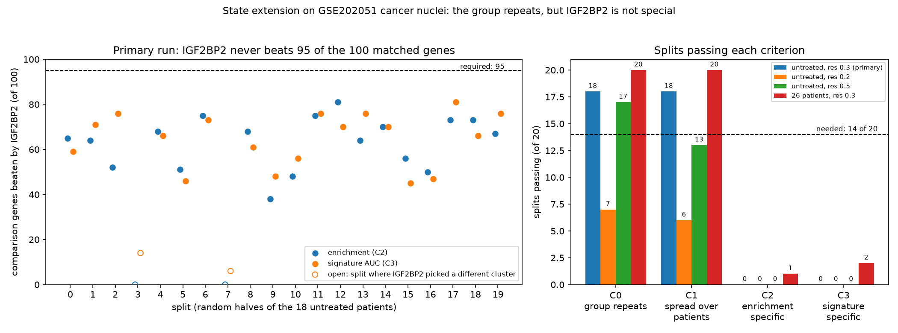
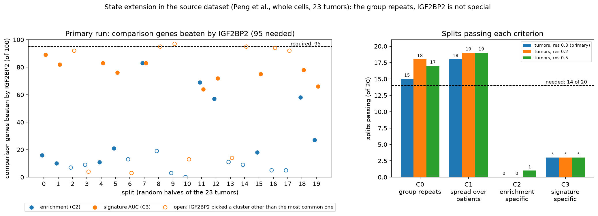

# A spatially aware reassessment of an IGF2BP2-high malignant state in pancreatic ductal adenocarcinoma

[Your full name] | BINF6420 | [date]

## Abstract

Chen et al. (2026) describe a pancreatic cancer cell state marked by high IGF2BP2 and link it to lipid metabolism and an immunosuppressive microenvironment [CITE]. We reassessed part of this claim with public data and a design that fixes the analysis rules before results are seen, counts tumors or patients as the independent units, and uses negative controls. In the spatial and single cell data of Moncada et al. (GSE111672; nine arrays from five tumors), IGF2BP2 linked genes found in one tumor did not reproduce in the other, and IGF2BP2 detection in spots showed no clear association with a lipid score (mean effect 0.068 SD, 95% interval -0.108 to 0.245) or a macrophage score (-0.098 SD, -0.237 to 0.041); a positive control failed, and only effects of about 0.4 SD would have met our criterion. In an independent single nucleus dataset (GSE202051; 18 untreated patients, 52,999 cancer nuclei), a program derived in the other patients separated IGF2BP2 detected nuclei (mean AUC 0.566), but 49 of 100 detection matched random genes did as well or better, and the lipid score was not higher in IGF2BP2 detected nuclei (-0.042 SD, -0.101 to 0.017). We then rebuilt the group by clustering patient aligned cancer cells and testing it on held out patients (20 random splits), first in these nuclei and then in the source dataset of the paper (Peng et al.; whole cells, 23 untreated tumors, the original authors' cancer cell labels). In both, a cancer cell cluster with more IGF2BP2 recurred across patients (outcome B), but IGF2BP2 did not stand out from its 100 matched comparison genes: it beat 95 of them in enrichment in 0 of 20 splits in both datasets, and in signature in 0 of 20 (nuclei) and 3 of 20 (whole cells) splits, against the 14 needed. We conclude that these data give no evidence for an IGF2BP2 specific malignant state with lipid or immune links. They cannot refute the original claim, because we could not reuse the paper's state definition, and our tests use our own clustering or IGF2BP2 detection as a stand in.

## 1. Introduction

Pancreatic ductal adenocarcinoma has a dense, immunosuppressive microenvironment. Chen et al. (2026) report a malignant cell state, State 3, with high IGF2BP2, and propose that it promotes immune evasion through lipid metabolism and PD-L1 localization, with a candidate drug [CITE]. Their spatial validation used sections of two tumors (PDAC-A and PDAC-B) from Moncada et al. (2020) and spot-level correlations between a state score and a T-cell exhaustion score [CITE].

Spot-level correlations in spatial transcriptomics can mislead for three reasons. A spot mixes many cells, so a spot rich in tumor cells scores high for every tumor-related gene whatever its surroundings. Spots near each other resemble each other, which inflates significance. And sequencing depth varies between spots. A fair test therefore needs adjustment for composition and depth, a null model that respects spatial structure, negative controls, and tumors, not spots, as the units of replication.

We asked whether the IGF2BP2-high state is reproducible across tumors, and whether it co-locates with lipid and immune signatures once these problems are addressed. The supplement of Chen et al. contains no gene list for State 3, so the state could not be reused and was approximated by IGF2BP2 detection. Section 5 discusses what that choice limits.

## 2. Methods

### 2.1 Data
GSE111672 (Moncada et al. 2020) provided single-cell RNA-seq for tumors A (1,926 cells) and B (1,733 cells), and nine spatial arrays from five tumors: A1 to A3 (428, 316, 288 spots), B1 to B3 (224, 321, 242), D (429), E (359), and G (288). Arrays from one tumor are not independent, so the unit of replication is the tumor (A, B, D, E, G). PDAC-F was excluded because its file was truncated (5,757 genes, IGF2BP2 absent), and PDAC-C because it has no spatial data. A matched single-cell reference exists only for tumors A and B.

GSE202051 (Hwang et al. 2022) provided an external single-nucleus dataset: 224,988 nuclei, 22,164 genes, 43 patients, with the authors' cell-type labels and treatment status. The authors' labels identify 64,538 cancer nuclei, identically in three label columns. Chen et al. also used this dataset for other analyses [CITE].

### 2.2 Cleaning and quality control
PDAC-D contained 29 duplicated spot columns with identical content, and the first of each was kept. Twenty-seven gene names that a spreadsheet had converted to dates (for example 1-Mar) were renamed and excluded from all signatures. Median UMIs per spot varied seven-fold between arrays (403 in A3 to 2,994 in D), so log total UMI was a covariate in every spatial model. IGF2BP2 was detected in 4 to 16% of spots (14 to 47 spots per array), and single-gene maps were not interpretable, so multi-gene scores were used.

### 2.3 Single-cell annotation
Cells were normalized and clustered (Leiden, resolution 0.8; 18 clusters in tumor A and 16 in B) and labeled by marker genes. Candidate cancer cells were clusters 5 and 6 in tumor A (276 cells) and cluster 0 in tumor B (338 cells). They agree with markers reported by Moncada et al. (TM4SF1, S100A4). Copy-number evidence was not available, so these are candidates and not confirmed malignant cells.

### 2.4 Reproducibility gate (step 03)
In candidate cancer cells of each tumor we tested every gene for association with IGF2BP2 detection (t statistic, adjusting for depth and a cell-cycle score; 3,908 genes). A program (the top 100 genes) from one tumor was tested in the other by AUC, against shuffles of IGF2BP2 labels among cells of similar depth. The gate, fixed in advance, required both held-out AUCs above 0.5 with p < 0.05 and a significant top-100 overlap.

### 2.5 Spatial tests (step 04)
Per-spot scores were the mean z-scored expression of each signature: a 15-gene lipid score (hypothesis H1), a macrophage score (H2), and epithelial and stromal scores as covariates. Exposure was IGF2BP2 detection. Each model adjusted for log total UMI, epithelial score, and stromal score. Significance used a block-permutation null (5 by 5 grid units, 1,000 shuffles) and a comparison with 200 matched random gene sets per outcome. A positive control (a stress module against the stromal score) was included. Results were aggregated over the five tumors, and the criterion fixed in advance required the same sign in at least four of five tumors, a 95% t-interval excluding zero, and a median p against random sets below 0.05.

### 2.6 Post-hoc diagnostics (step 05)
Three post-hoc checks followed. A spike-in added known shifts to the lipid score of IGF2BP2-detected spots to find the smallest effect that meets the criterion. A split-half control tested whether two random halves of a signature co-vary through the same models. And the average test statistic of matched random gene sets was computed per array, to detect bias.

### 2.7 External check (steps 07 to 09)
Cancer nuclei were those labeled "Epithelial (malignant)". A patient was eligible with at least 30 cancer nuclei with and 30 without IGF2BP2 counts; all 18 untreated patients were eligible, and 26 patients overall. The primary population was the untreated patients.

E1 asked whether an IGF2BP2-linked program reproduces across tumors. For each patient, genes were tested against IGF2BP2 detection (adjusting for depth and cell cycle), a 100-gene program was built from the other patients, and its score was tested in the held-out patient by AUC. The statistic was the mean AUC over patients, against 200 shuffles of detection among nuclei of similar depth. E1 passed if the mean AUC exceeded 0.5, the empirical p was at most 0.05, and at least 60% of patients had an AUC above 0.5. E2 asked whether the lipid score is higher in IGF2BP2-detected cancer nuclei, using the same covariates and 200 random gene sets per patient. A secondary exposure (expression above the patient's median) was added before any association was computed.

Step 09 (post-hoc) re-ran E1 with additional covariates (log detected genes, a nuclear lncRNA score), with lncRNA-like genes barred from programs, and with 100 random genes whose per-patient detection matched IGF2BP2 as the exposure.

### 2.8 Pre-specification and reproducibility
Analysis rules were committed before their results existed, and every later addition is labeled post-hoc in `docs/input_manifest.md`. The external plan is commit 6f419e3, the secondary exposure dc82ec8, the analysis script and clarifications 804a97b, and the robustness plan 1ae8e72. The pipeline is Nextflow on Slurm with fixed seeds (Python 3.11, scanpy 1.11.5). A clean-room run of the main pipeline from a fresh clone (dc82ec8) completed in 7 minutes 17 seconds, with ten key result tables byte-identical to the original runs.

### 2.9 State extension in the independent dataset (steps 11 and 12)
Question A was tested in GSE202051 as an independent dataset: single nuclei from different patients, clustered by us. It is not the paper's method on the paper's data. The plan, the rule for when the group counts as having come back, and the three outcomes were committed before any clustering was run (plan: commit c38d789 on 22 October 2026; the plan text was accidentally overwritten in commit e9a0f9b and restored unchanged in commit 3f2b2c0, before any state analysis was run; clarifications: commit e9a0f9b).

IGF2BP2 and 100 comparison genes were chosen before any map existed: the genes closest to IGF2BP2 in per patient detection fraction and in mean log expression among detected cancer nuclei, among genes with at least 30 detected and 30 undetected nuclei in every patient, excluding lncRNA-like genes. All 101 genes were removed from the inputs of the map. The map used 3,000 variable genes chosen across patients, PCA with 30 components, Harmony with patient as the batch, a neighbor graph with 30 neighbors, and Leiden clustering at resolution 0.3 (primary), 0.2 and 0.5. A variant with exactly three clusters, as in the paper, could not be formed: no resolution in the grid gave exactly three clusters of at least 5 percent of the nuclei each.

The patients were split at random 20 times into a discovery half and a validation half (9 and 9 for the 18 untreated patients, the primary run; 13 and 13 for all 26 eligible patients, with treated and untreated patients split evenly, the secondary run). In the discovery half, for IGF2BP2 and for each comparison gene separately, the cluster with the largest mean difference in detection fraction (inside minus outside) was found, and a 100 gene signature was built from the genes with the largest t statistic of the inside minus outside difference in expression. In the validation half four criteria were evaluated. C0: IGF2BP2 is more often detected inside the cluster, and the signature separates nuclei with IGF2BP2 from nuclei without it (AUC above 0.5, in at least 60 percent of the validation patients). C1: at least 60 percent of the validation patients have at least 5 percent of their nuclei in the cluster. C2 and C3: the enrichment and the signature AUC of IGF2BP2 exceed those of at least 95 of the 100 comparison genes. A criterion holds if it passes in at least 14 of the 20 splits. The outcomes were fixed in advance. A: C0 to C3 hold, the group repeats and IGF2BP2 is special. B: C0 and C1 hold but C2 or C3 fails, the group repeats but IGF2BP2 is one marker among many. C: C0 or C1 fails, the group does not repeat in this dataset. The lipid test (C4) was to be evaluated only if C1 to C3 held. A smoke test with 3 splits was run first, and no rule was changed after it.

### 2.10 State extension in the source dataset of the paper (steps 15, 11 and 12)
The same procedure was applied to the dataset in which the paper defined its state, in the copy deposited by Roche (Zenodo 10.5281/zenodo.3969339, Besca reprocessing of PRJCA001063; the file checksum is recorded in the manifest): 10x Chromium v2 single cells from 24 primary PDAC tumors and 11 control pancreases, none treated according to the original paper. This copy is not necessarily identical to the data processed by Chen et al. Cancer cells were the cells that the original authors labeled "Ductal cell type 2", which they identified as malignant by copy number variation; a label check fixed in advance required at least 90 percent of them to come from tumor samples (all 11,315 did). A tumor was eligible with at least 30 cancer cells with and 30 without IGF2BP2 counts (23 of 24 tumors; threshold 8). Counts were normalized to 10,000 per cell and log transformed. Everything else (comparison genes, map, splits, criteria, outcomes) followed section 2.9, with halves of 11 and 12 tumors. The plan was committed before any IGF2BP2 value or association was read in this dataset (commit daef1c8); the structure of the file had been inspected and the average IGF2BP2 expression by cell type had been seen on the TISCH2 portal. A smoke test with 3 splits preceded the full run, and no rule was changed after it.

## 3. Results

### 3.1 Cell calls
Candidate cancer cells carried IGF2BP2 counts more often than other epithelial cells (about 53% and 54% against 31% and 22% in tumors A and B) and far more often than all other cells (Figure 1). IGF2BP2 is therefore partly a cancer-lineage marker, which is why tumor content must be adjusted for.

### 3.2 Reproducibility gate
The gate was not passed (Figure 2). The top-100 overlap was one gene (DIP2B) against 2.6 expected by chance (p = 0.935). The held-out AUC was 0.459 from A to B (p = 0.932) and 0.554 from B to A (p = 0.048). Across 3,908 genes the correlation of the two tumors' statistics was 0.008.

### 3.3 Spatial tests
No outcome met the criterion (Table 1, Figure 4). The positive control failed: the stress score was slightly negative against the stromal score in all five tumors.

| Outcome | Tumors positive | Mean effect (SD) | 95% interval | Median p vs random sets |
|---|---|---|---|---|
| Control (stress vs stromal) | 0 of 5 | -0.046 | -0.077 to -0.015 | 0.592 |
| H1 lipid | 3 of 5 | 0.068 | -0.108 to 0.245 | 0.562 |
| H2 macrophage | 1 of 5 | -0.098 | -0.237 to 0.041 | 0.726 |
| Exploratory: lipid-associated macrophages | 2 of 5 | -0.026 | -0.249 to 0.196 | not computed |
| Exploratory: T-cell exhaustion | 3 of 5 | 0.140 | -0.160 to 0.440 | not computed |

*Table 1. Tumor-level results of the spatial tests. Exhaustion genes were detected in 0 to 8% of spots, so that outcome is exploratory.*

### 3.4 Diagnostics
These results are post-hoc (Figure 5). The spike-in showed that the criterion would first have been met at a 0.4 SD shift (interval 0.287 to 0.629, median p 0.040), and not at 0.3 SD (median p 0.114). The interval of the unshifted analysis implies a minimum detectable effect of about 0.24 SD at 80% power, ignoring the random-set condition.

The split-half control recovered co-variation for the stromal signature (0.388 SD, 0.213 to 0.564) and the macrophage signature (0.175, 0.052 to 0.298), but not for the lipid signature (0.049, -0.033 to 0.131) or the stress signature (0.055, -0.001 to 0.111). The stress control was therefore built on a score that does not hang together in these data, and the lipid score is a weak outcome measure.

Matched random gene sets showed no material bias on average (mean test statistic 0.107, 0.391, and 0.251 for the control, H1, and H2 models; threshold 0.5), but array A3 was a clear exception (2.34 for H1 and 1.80 for H2), and A2 a milder one. After correction against random sets, H1 was near zero (-0.012, interval -0.694 to 0.670) and H2 leaned negative with an interval that includes zero (-0.595, -1.512 to 0.321).

### 3.5 External check
IGF2BP2 was detected in 28 to 90% of cancer nuclei per untreated patient. E1 passed in all four analyses (Table 2). In the untreated patients the mean held-out AUC was 0.566, above 0.5 in 17 of 18 patients, against a shuffled null of 0.503. The secondary exposure and the larger population gave the same result.

| Population | Exposure | Patients | Mean AUC (95% interval) | Patients above 0.5 | Null mean | p |
|---|---|---|---|---|---|---|
| Untreated | detected | 18 | 0.566 (0.544 to 0.589) | 17 | 0.503 | 0.005 |
| Untreated | above median | 18 | 0.576 (0.556 to 0.596) | 18 | 0.502 | 0.005 |
| All eligible | detected | 26 | 0.573 (0.551 to 0.595) | 25 | 0.504 | 0.005 |
| All eligible | above median | 26 | 0.575 (0.556 to 0.593) | 26 | 0.502 | 0.005 |

*Table 2. E1, leave-one-tumor-out reproducibility. p = 0.005 is the smallest value 200 shuffles allow.*

E2 was not met in any analysis (Table 3). The lipid score was, if anything, slightly lower in IGF2BP2-detected nuclei, and the effects were no larger than those of matched random gene sets.

| Population | Exposure | Mean effect (SD) | 95% interval | Patients positive | Median p vs random sets |
|---|---|---|---|---|---|
| Untreated | detected | -0.042 | -0.101 to 0.017 | 7 of 18 | 0.381 |
| Untreated | above median | -0.051 | -0.089 to -0.014 | 5 of 18 | 0.353 |
| All eligible | detected | -0.051 | -0.100 to -0.003 | 9 of 26 | 0.391 |
| All eligible | above median | -0.031 | -0.067 to 0.006 | 8 of 26 | 0.391 |

*Table 3. E2, lipid score in cancer nuclei.*

The robustness checks changed the interpretation of E1 (Table 4, Figure 6). Adding covariates, or removing lncRNA-like genes from the programs, left the mean AUC at 0.566 to 0.572. But with random genes detected at similar rates as the exposure, the mean AUC was 0.572 (SD 0.035, maximum 0.661), and 49 of the 100 genes reached or exceeded the AUC of IGF2BP2. The rule fixed in advance allowed at most 5. A closer-matched subset (the 25 nearest genes, chosen after seeing the result) averaged 0.555, and 6 of 25 reached or exceeded 0.566. IGF2BP2 is therefore not distinguishable from genes detected at similar rates.

| Variant | Mean AUC (95% interval) | p |
|---|---|---|
| V0 baseline | 0.566 (0.544 to 0.589) | 0.005 |
| V1 + log detected genes | 0.570 (0.548 to 0.593) | 0.005 |
| V2 + nuclear lncRNA score, lncRNA-like genes removed | 0.568 (0.547 to 0.588) | 0.005 |
| V3 both | 0.572 (0.551 to 0.592) | 0.005 |
| V4 100 matched random genes | mean 0.572, max 0.661; 49 of 100 at or above 0.566 | not applicable |

*Table 4. Post-hoc robustness of E1 (untreated patients, primary exposure).*

*Figure 6. External check on GSE202051 (untreated patients, primary exposure). Top left: mean held-out AUC of 100 random genes detected at similar rates (histogram) against IGF2BP2 (red) and the shuffled-label null (dashed). Top right: held-out AUC for each patient. Bottom left: the robustness variants against the spread of the random genes. Bottom right: lipid score effect of IGF2BP2 detection for each patient.*

### 3.6 State extension in the independent dataset
The extension ran on the 18 untreated patients (52,999 cancer nuclei), which formed 7 clusters at the primary resolution of 0.3. IGF2BP2 was most enriched in cluster 1 in 18 of the 20 splits. Cluster 1 is the largest cluster, with 21,703 nuclei (40.9 percent); 15 of the 18 patients have at least 5 percent of their nuclei in it, and no patient supplies more than 19.4 percent of it. In the other two splits IGF2BP2 picked cluster 6, which is 98 percent one patient's nuclei, and the rules rejected it. In validation patients IGF2BP2 was detected 0.108 more often inside cluster 1 than outside (range 0.071 to 0.146), and the signature built in the discovery patients gave a mean AUC of 0.540 (0.524 to 0.554).

C0 and C1 passed in 18 of 20 splits, so the group repeats. C2 and C3 passed in none of the 20 splits: IGF2BP2 beat on average 63 of the 100 comparison genes on enrichment (range 38 to 81) and 65 on the signature AUC (range 45 to 81), against the 95 required (Figure 7). The outcome is B: the group repeats, but IGF2BP2 is not special. The lipid test was therefore not evaluated.

| Population | Resolution | C0 | C1 | C2 | C3 | Outcome |
|---|---|---|---|---|---|---|
| 18 untreated (primary) | 0.3 | 18 | 18 | 0 | 0 | B |
| 18 untreated | 0.2 | 7 | 6 | 0 | 0 | C |
| 18 untreated | 0.5 | 17 | 13 | 0 | 0 | C |
| 26 eligible | 0.3 | 20 | 20 | 1 | 2 | B |
| 26 eligible | 0.2 | 8 | 7 | 0 | 0 | C |
| 26 eligible | 0.5 | 19 | 19 | 0 | 0 | B |

*Table 5. Splits passing each criterion (of 20; 14 are needed). C0 the group repeats, C1 spread over patients, C2 enrichment specific to IGF2BP2, C3 signature specific to IGF2BP2.*

*Figure 7. State extension on GSE202051 cancer nuclei. Left: for each of the 20 splits of the primary run, the number of the 100 comparison genes that IGF2BP2 beat on enrichment (blue) and on signature AUC (orange); open points mark the two splits in which IGF2BP2 picked a patient specific cluster; the dashed line is the 95 required. Right: splits passing each criterion in four of the six runs (all six are in Table 5), against the 14 needed.*

The sensitivities agree on the main point. At resolution 0.2 the group does not repeat. At 0.5 the untreated run is labeled C only because C1 passed in 13 splits, one short of 14, although C0 passed in 17; with 26 patients the same resolution gives B. C2 and C3 passed in 1 and 2 of the 120 splits of the six runs, so the conclusion that IGF2BP2 is not special does not depend on the population or the resolution. With the treated patients included, IGF2BP2 ranked somewhat higher (it beat on average 78 of the 100 comparison genes on the signature AUC at resolution 0.3), which was not investigated further because an analysis of the 8 treated patients alone would be post hoc and underpowered.

### 3.7 State extension in the source dataset of the paper
23 of the 24 tumors were eligible (tumor T12 had 44 cancer cells), holding 11,271 cancer cells (92 to 1,696 per tumor); IGF2BP2 counts were present in 57 percent of the cancer cells. At the primary resolution of 0.3 the map had 7 clusters. The cluster in which IGF2BP2 was most enriched in the discovery half changed with the split: cluster 1 (41 percent of the cells) in 10 splits, cluster 2 (23 percent) in 6 and cluster 4 (7 percent) in 4, against cluster 1 in 18 of 20 splits in the nuclei. In validation tumors IGF2BP2 was detected 0.038 more often inside the chosen cluster than outside on average (0.108 in the nuclei), and the signature gave a mean AUC of 0.544 over the 20 splits (0.536 in the nuclei).

C0 passed in 15 of 20 splits and C1 in 18, so the group repeats, although C0 is only just above the 14 required. C2 passed in none and C3 in 3. IGF2BP2 beat on average 23 of the 100 comparison genes on enrichment (maximum 83) and 68 on the signature AUC (maximum 97), against the 95 required (Figure 8). The outcome is B. The three splits in which C3 passed all chose cluster 2, where IGF2BP2 beat 95, 97 and 95 comparison genes on the signature AUC, but its enrichment inside that cluster was small (detection difference 0.005 to 0.049); by the criteria fixed in advance this is not support. In the four splits that chose cluster 4 the signature pointed the wrong way (mean AUC 0.484).

| Population | Resolution | C0 | C1 | C2 | C3 | Outcome |
|---|---|---|---|---|---|---|
| 23 tumors (primary) | 0.3 | 15 | 18 | 0 | 3 | B |
| 23 tumors | 0.2 | 18 | 19 | 0 | 3 | B |
| 23 tumors | 0.5 | 17 | 19 | 1 | 3 | B |

*Table 6. Splits passing each criterion in the source dataset of the paper (of 20; 14 are needed).*

*Figure 8. State extension in the source dataset of the paper (whole cells, 23 tumors). Left: for each of the 20 splits of the primary run, the number of the 100 comparison genes that IGF2BP2 beat on enrichment (blue) and on signature AUC (orange); open points mark splits in which IGF2BP2 picked a cluster other than the most common one (cluster 1); the dashed line is the 95 required. Right: splits passing each criterion at the three resolutions, against the 14 needed.*

| | Nuclei (GSE202051) | Whole cells (source dataset) |
|---|---|---|
| Patients or tumors | 18 untreated | 23 untreated |
| Cancer cells | 52,999 nuclei | 11,271 cells |
| C0, C1, C2, C3 passing (primary) | 18, 18, 0, 0 | 15, 18, 0, 3 |
| Cluster chosen for IGF2BP2 | cluster 1 in 18 of 20 splits | cluster 1 in 10, cluster 2 in 6, cluster 4 in 4 |
| Detection difference inside versus outside | 0.108 | 0.038 |
| Comparison genes beaten, enrichment (mean of 20 splits) | 57 | 23 |
| Comparison genes beaten, signature AUC (mean of 20 splits) | 59 | 68 |
| Outcome | B | B |

*Table 7. The two state extensions compared (primary resolution 0.3).*

The two datasets agree on the outcome and differ in the details. In the whole cells the group is less stable, IGF2BP2 is detected in so many cancer cells that little enrichment is possible, and the signature is slightly more specific than in the nuclei. The three splits in which IGF2BP2 beat 95 comparison genes on the signature all picked one cluster. C2 and C3 passed in 2 and 11 of the 180 splits of the nine runs of the two datasets, and in no run in more than 3 of 20.

## 4. Discussion

Five findings stand out. The spatial test is inconclusive: the data exclude a large lipid or macrophage effect but cannot see a small one, and the positive control failed because its score is incoherent here, not because the pipeline fails (the stromal and macrophage signatures were recovered). Dropping array A3, or any one tumor, did not change a verdict (post hoc: without A3 the H1 mean is 0.048, interval -0.089 to 0.184, and the H2 mean is -0.087, interval -0.226 to 0.052; with any single tumor dropped the means range from 0.018 to 0.109 for H1 and from -0.134 to -0.057 for H2, and every interval includes zero). The reproducibility gate failed in two tumors, but with roughly 300 candidate cells per tumor it could miss a modest effect. The external single nucleus check found a reproducible association that is not specific to IGF2BP2, and no lipid link in cancer nuclei, which is the paper's own single cell claim. The state extension in these nuclei, the closest we could come to rebuilding the group as the paper did, found a broad cancer cell population with more IGF2BP2 that recurs across patients, but IGF2BP2 did not stand out from genes matched on detection and expression. And the same procedure in the source dataset of the paper, with whole cells and the original authors' malignant labels, gave the same outcome.

The last three results agree and come from different routes. In the matched gene control of step 09, 49 of 100 genes detected at similar rates reached the IGF2BP2 AUC. In the state extension in nuclei, IGF2BP2 beat on average 57 (enrichment) and 59 (signature) of its 100 comparison genes over the 20 primary splits (63 and 65 in the 18 splits that chose the largest cluster), and never 95: C2 and C3 passed in 0 of the 20 primary splits. In the source dataset it beat on average 23 on enrichment and 68 on the signature AUC; C2 passed in none and C3 in 3 of 20 splits. Over the nine runs of the two datasets, C2 and C3 passed in 2 and 11 of the 180 splits, and no run came near the 14 required. All of it says that IGF2BP2 is one marker among many of a shared axis of variation among cancer cells. The agreement of nuclei and whole cells argues against a purely nuclear technical artifact, although the consensus program of the nuclei analysis contains IGF2BP2-AS1 (the antisense transcript at the same locus), the nuclear lncRNAs MALAT1, NEAT1 and FTX, and many genes we believe to be long (not verified against an annotation), so a technical contribution cannot be excluded. The clusters that IGF2BP2 picked are broad populations (41 percent of the nuclei; 41, 23 and 7 percent of the whole cells), not rare distinct states. These data cannot say whether the shared axis is technical or biological, and a gene length matched control would be needed to try. In six public PDAC single cell datasets on TISCH2 (post hoc, from a web portal whose processing we did not verify), the genes most correlated with IGF2BP2 across cell types were epithelial and cell junction genes (for example CGN, TACSTD2, EPHA2, SFN, DSG2, PATJ); the repeated correlation values suggest that these are computed across cell type averages, so they reflect lineage and not a within cancer cell state.

The two state extensions differ in the details. In the whole cells the group was less stable: C0 passed in 15 of 20 splits against 14 needed, and the cluster IGF2BP2 picked depended on the discovery half (cluster 1 in 10 splits, cluster 2 in 6, cluster 4 in 4, against 18 of 20 in the nuclei). IGF2BP2 is detected in 57 percent of the cancer cells there, so little enrichment was possible (0.038 higher inside the chosen cluster, 0.108 in the nuclei). The signature, in contrast, was a little more specific: in the six splits that chose cluster 2, IGF2BP2 beat 92 to 97 comparison genes on the signature AUC. By the rules fixed in advance this is not support, because the enrichment in that cluster is small and three splits are far from the 14 required; it was not investigated further, since choosing that cluster after seeing the table would be post hoc.

The design lessons are the most transferable result. Our external pass rule for the program test (E1) tested for a reproducible association and not for specificity to IGF2BP2, so E1 passed as written, and the matched gene check was added because of that gap. In the state extensions the specificity requirement (beat 95 of 100 matched genes) was written before the run. More data would not have helped on its own: with 53,000 nuclei the estimates were precise, and what they measured was not specific. More data reduces noise, not bias.

What the spatial test could see needs a careful statement. For a yes or no exposure detected in 4 to 16 percent of spots, an effect of 0.24 SD (80 percent power) corresponds to a correlation of about 0.05 to 0.09, and our criterion (0.40 SD) to about 0.08 to 0.15. The paper's correlation between its state score and the lipid program (about 0.16 in single cells, by our reading of its Figure 2F, not verified) is a different quantity, and IGF2BP2 detection is only a noisy stand in for the state, so a true state level association could be diluted below our detectable range. Effects above about 0.25 SD per detected spot are unlikely in these data; smaller effects, or effects carried by the state and not by IGF2BP2 detection, remain possible.

These results do not refute Chen et al. Their state is defined by clustering cancer cells with a gene list that is not public, so we tested related but different quantities: IGF2BP2 detection, and clusters found by our own procedure, in nuclei from other patients and in a processed copy of the paper's source dataset (the paper reports 12,847 cells after its filtering, while the copy has 41,986 tumor cells). A negative result means no IGF2BP2 specific group in these data by these methods. Nothing here bears on their survival analysis, the SGMS2 and PD-L1 mechanism, or the drug experiments.

## 5. Limitations

- Five tumors in the spatial analysis, with arrays that have 20 to 70 cells per spot, shallow depth, and almost no detectable immune genes.
- IGF2BP2 detection is a noisy stand in for the state, which has no public gene list. Both state extensions used our own clustering (Harmony and Leiden), so a negative result cannot be read as a failure to reproduce the paper.
- The copy of the source dataset (Roche reprocessing of the data of Peng et al.) is not necessarily what Chen et al. processed. Its cancer cell labels are the original authors' and rest on copy number variation.
- The maps were built on all patients, including those of the validation half (mild transduction); the discovery of the cluster and the signature used only the discovery half.
- The results depend on the clustering resolution (in the nuclei the group repeats at 0.3 but not at 0.2), and in the whole cells C0 passes in 15 of 20 splits against 14 needed and the chosen cluster changes with the discovery half. The three cluster variant of the paper could not be formed in either dataset.
- The comparison genes match IGF2BP2 on detection and expression level but not on gene length, and the nature of the shared axis (technical or biological) is not determined. In the whole cells IGF2BP2 is detected in 57 percent of the cancer cells, which leaves little room for enrichment.
- Cancer cells in GSE111672 are called from marker genes only. The GSE202051 labels are the authors' and may contain errors; another recent atlas reports that RNA inferred copy number was an unreliable cancer cell anchor in its pooled data [CITE]. The stricter label sensitivity was not run.
- The lipid and macrophage gene lists were chosen for this project and are not the paper's scores. The lipid test of the state extensions (C4) was not evaluated because C1 to C3 did not all hold; the lipid result in cancer nuclei comes from the earlier test (E2) only.
- GSE202051 was also used by Chen et al. for their treatment analysis.
- Steps 05 and 09, the leave one out tables, the TISCH2 observation and the effect size conversions are post hoc.

## 6. Conclusion

These data provide no evidence for an IGF2BP2 specific malignant state with lipid or immune links, and they cannot refute the original claim. The spatial test is inconclusive and the two tumor reproducibility gate failed. In two independent single cell datasets, one of them the source dataset of the paper, a broad cancer cell population with more IGF2BP2 recurs across patients, but IGF2BP2 is not distinguishable from genes matched on detection and expression, and the lipid score is not higher in IGF2BP2 detected nuclei. The work shows how a stand in exposure, depth, composition and shared axes of variation can each produce convincing but misleading results, and how matched gene controls and rules fixed in advance expose them.

## 7. Future work

The most informative next steps remove our main limitation, the missing definition of the paper's state. First, obtain from the authors the State 3 gene list, the clustering settings, the lipid, hypoxia, macrophage and exhaustion gene lists, and their processing of PAAD_CRA001160 (they report 12,847 cells after filtering, which differs from the copy used here), so that the question could be tested with the paper's own method, with the same specificity controls. Second, a control matched on gene length and the stricter cancer cell label sensitivity would help to separate technical from biological sources of the shared axis. Third, a frozen signature from such a state could be applied to better spatial data (a larger Visium cohort, or single cell resolution spatial data if IGF2BP2 is measured), with patients as the units. Fourth, the survival claim could be checked in bulk cohorts adjusted for tumor purity. Causal claims would need experimental validation.

## 8. AI assistance

Claude (Anthropic) was used as a coding and planning assistant. It wrote the scripts, tested their logic on synthetic data in a sandbox without access to the real data, and drafted documentation. I ran all analyses on the cluster and reviewed the outputs. No model runs inside the pipeline.

## 9. Data and code availability

Code, plans, result tables, and figures: https://github.com/SaagarTank1209/igf2bp2-pdac-sc-spatial-reassessment. Data are public (GEO GSE111672 and GSE202051) and are not stored in the repository. `scripts/download_data.sh` fetches GSE111672.

## References

[CITE: Chen et al. 2026; Moncada et al. 2020; Hwang et al. 2022; the 2026 atlas preprint; others as needed]